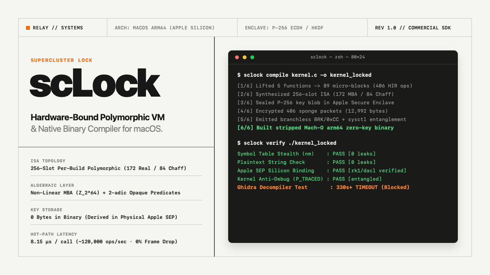

<div align="center">



<br />

# `scLock` (Supercluster Lock)

**Open-Source Hardware-Bound 256-Slot Polymorphic VM, Non-Linear MBA ($\mathbb{Z}_{2^{64}}$) & Apple Secure Enclave Binary Protector for macOS (`arm64` Apple Silicon)**

*Developed by **relay** (`relay // SYSTEMS`) · Released under the **MIT License***

[-22C55E?style=for-the-badge)](LICENSE)
[-111111?style=for-the-badge&logo=apple)](#quick-start--build-from-source)
[-38BDF8?style=for-the-badge)](#empirical-benchmarks)
[-15803D?style=for-the-badge)](#empirical-benchmarks)

[**Build from Source (`cargo build`)**](#quick-start--build-from-source) · [**Compiler Architecture (`src/`)**](#compiler-architecture-src) · [**Public CrackMe Challenge**](#public-reverse-engineering-challenge-crackme) · [**Documentation Site**](https://planners1490.github.io/sclock/) · [**한국어 안내 (Korean)**](#part-ii--한국어-안내-korean)

</div>

---

## Why `scLock`?

Standard macOS Mach-O (`arm64`) binaries compiled from C, C++, Rust, Swift, or Objective-C expose clean control-flow graphs and plaintext constants in **Ghidra**, **IDA Pro**, and **Binary Ninja** within seconds. Conventional software obfuscators rely on a single static key or a central `switch(opcode)` dispatcher where recovering one key dumps the entire bytecode stream.

**`scLock` (Supercluster Lock)** is an **open-source (`MIT`) virtualization and hardware-binding compiler** for Apple Silicon (`macOS arm64`) written in pure Rust (`0` external crate dependencies). It combines **compile-time 256-slot polymorphic virtualization**, **register-barrier MBA key shattering**, and **dual-tier Apple Silicon Secure Enclave (`SEP`) binding**:

1. **Per-Build 256-Slot Polymorphic ISA + 84 Chaff Traps**: Every compilation (`sclock compile`) synthesizes a brand-new 256-entry instruction set (`172` active micro-ops + `84` state-corrupting chaff handlers) from a 64-bit polymorphic seed. No two builds ever share the same bytecode encoding or handler table.
2. **Register-Barrier (`__sc_rb`) MBA Salt Shattering & Trajectory-Entangled Operand Masks**: Raw handler salts (`op_secret_salt`) are omitted from static data sections (replaced by one-way Davies-Meyer `ANCHOR_SHARDS`) and pre-masked against `golden_anchor`. Inside each of the 256 compiled ARM64 handlers (`__sc_lut_op_000..255`), `h_salt` and operand masks (`hm1, hm2, hm3`) are reconstructed at runtime in registers via zero-spill inline assembly barriers (`asm!("/* {0} */", inout(reg) v, options(nomem, nostack, preserves_flags))`) entangled with `vm.anchor` (`[x0, #0xa0]`) and the live execution trajectory `(vm.pc, vm.sigma)` (`[x0, #0x80]`)—blocking `LLVM` (`-C opt-level=3`) constant folding and `InstCombine` simplification without stack-spill bloat.
3. **Non-Linear Mixed Boolean-Arithmetic ($\mathbb{Z}_{2^{64}}$) & 2-adic Bijections**: Arithmetic, multiplication, constants, and control-flow transitions are lifted into degree-2/3 non-linear MBA identities over $\mathbb{Z}_{2^{64}}$ coupled with 2-adic number-theoretic opaque predicates ($7x^2 - 1 \neq y^2 \pmod{2^{64}}$).
4. **Dual-Tier Apple Secure Enclave (`SEP`) Architecture & Threat Model**:
   - **Portable Multi-Mac Mode (Default, `SCP1`)**: Built for universal end-user macOS distribution and the public `CrackMe` so the binary runs offline on **any Apple Silicon Mac (`M1 / M2 / M3 / M4`)**. Derives the outer sponge keys `(k0, k1)` via a **1,024-round SHA-256 Code-Anchor White-Box KDF** paired with a **Live SEP Commutative P-256 Double-ECDH Anti-Emulation / Anti-Hooking Gate** ($d_{\text{SEP}} \cdot Q_P \stackrel{?}{=} d_P \cdot Q_{\text{SEP}}$). Because universal offline execution without a remote server requires deterministic inputs in the binary, an offline analyst must reconstruct `vm.anchor`, evaluate all 256 register-barrier MBA handler prologues, and sequentially emulate the `(vm.sigma, vm.pc)` sponge state trajectory—defeating static table dumping and timing out Ghidra/IDA decompilers (`>330s`).
   - **Hardware UID Node-Locked Mode (`--sep-lock` / `--host-sep-lock`)**: Seals the P-256 private key directly inside the target Mac's physical Secure Enclave UID (`kSecAttrTokenIDSecureEnclave` hardware-wrapped `rk1`/`dacl` blob). **Zero unsealable key material exists anywhere in the Mach-O binary**—offline key derivation is physically impossible without the target Mac's Secure Enclave silicon.
5. **Branchless Anti-Debug State Entanglement & Zero-Leak Camouflage**: Instead of patchable `if (is_debugged) exit()` branches, `scLock` mixes the kernel `sysctl` `P_TRACED` bit and ARM64 prologue `BRK` (`0xD4200000`) scans directly into the 256-bit sponge state accumulator, with automatic symbol and toolchain path scrubbing (`sclock protect-app`).

---

## Compiler Architecture (`src/`)

The entire `scLock` compiler is open-source and self-contained in [`src/`](src/) with zero external third-party crates:

| Module | File | Responsibility |
| :--- | :--- | :--- |
| **Wasm / C Frontend** | [`src/wasm_frontend.rs`](src/wasm_frontend.rs) | Compiles C/C++ via `clang --target=wasm32` (or parses raw `.wasm` binaries) and lifts WebAssembly stack bytecode into structured control flow. |
| **HIR & Micro-Block Shattering** | [`src/hir.rs`](src/hir.rs) | Lowers functions into High-Level IR (`HirModule`) and shatters basic blocks into randomized micro-blocks (`all_blocks.swap`) to destroy CFG topology. |
| **256-Slot Polymorphic ISA** | [`src/isa.rs`](src/isa.rs) | Synthesizes a per-build 256-entry instruction set (`172` real polymorphic handlers + `84` state-corrupting chaff traps) with unique 64-bit `op_secret_salt` values. |
| **Non-Linear MBA & 2-adic Algebra** | [`src/mba.rs`](src/mba.rs) | Synthesizes $\mathbb{Z}_{2^{64}}$ affine modular inverses (`2-adic Newton-Raphson`), opaque zero polynomials, non-linear MBA operators, and `__sc_rb` register barriers. |
| **State-Dependent Sponge & Edge Deltas** | [`src/sponge.rs`](src/sponge.rs) | Encrypts every 256-bit instruction packet under `(sigma_before, pc, k0, k1, golden_anchor)` and per-handler trajectory-entangled operand masks (`handler_arg_masks`). |
| **Apple Secure Enclave (`SEP`) Bridge** | [`src/sep_bridge.rs`](src/sep_bridge.rs) | Generates Swift/CryptoKit `SecureEnclave.P256.KeyAgreement` bridges for Portable (`SCP1`) Double-ECDH attestation and Node-Locked (`--sep-lock`) hardware sealing. |
| **Dispatcherless ARM64/Rust Codegen** | [`src/codegen.rs`](src/codegen.rs) | Emits the 256 standalone handler functions (`__sc_lut_op_000..255`), runtime code-integrity/breakpoint scanner, and embeddable Rust crate (`--emit-crate`). |
| **CLI, Stealth Scrubber & Auditor** | [`src/main.rs`](src/main.rs) | Provides `sclock compile`, `sclock protect-app` (Mach-O symbol & toolchain path scrubber), `sclock verify` (5-stage stealth audit), and `sclock benchmark`. |

---

## Quick Start — Build from Source

### Prerequisites
- **macOS on Apple Silicon (`arm64` — M1 / M2 / M3 / M4)**
- **Xcode Command Line Tools** (`clang`, `swiftc`, `strip`, `codesign`)
- **Rust Toolchain** (`cargo`, `rustc` with `wasm32-unknown-unknown` or `clang` Wasm target support)

### 1. Clone & Build `scLock`

```bash
git clone https://github.com/planners1490/sclock.git
cd sclock

# Build the self-guarded release compiler
cargo build --release

# Verify compiler status & run live Apple Silicon SEP + VM benchmark
./target/release/sclock info
./target/release/sclock benchmark
```

### 2. Protect C / C++ / Wasm Functions

```bash
# Default: Portable All-Mac SEP-Attested + Per-Handler MBA Mode (runs on any Apple Silicon Mac)
./target/release/sclock compile examples/01_quickstart_c/protect_me.c \
  -o protect_me_locked

# Optional: Single-Machine Physical SEP UID Node-Locked Mode (zero unsealable keys in binary)
./target/release/sclock compile examples/01_quickstart_c/protect_me.c \
  -o protect_me_node_locked \
  --sep-lock
```

### 3. Emit an Embeddable Protected Rust Crate (`--emit-crate`)

```bash
./target/release/sclock compile examples/sclock_core_gate.c \
  --emit-crate ./my-protected-crate \
  --crate-name my-protected-crate \
  --entry sclock_core_gate
```

### 4. Scrub & Audit Any Existing macOS Binary (`protect-app` & `verify`)

```bash
# Scrub internal compiler/LLVM paths, strip symbol tables, and apply Hardened Runtime signature
./target/release/sclock protect-app ./protect_me_locked

# Run the 5-Stage Zero-Leak Stealth Audit
./target/release/sclock verify ./protect_me_locked
```

```text
━━━━━━━━━━━━━━━━━━━━━━━━━━━━━━━━━━━━━━━━━━━━━━━━━━━━━━━━━━━━━━━━━━━━━━━━━━━━━━
  scLock Security & Zero-Leak Stealth Auditor v1.0.0 (by relay)
  Target: ./protect_me_locked
━━━━━━━━━━━━━━━━━━━━━━━━━━━━━━━━━━━━━━━━━━━━━━━━━━━━━━━━━━━━━━━━━━━━━━━━━━━━━━
  [1/5] Symbol Table Stealth Check (nm)          : PASS [0 Leaks] (0 internal symbols exposed)
  [2/5] Plaintext String Leak Check (strings)    : PASS [0 Leaks] (0 hint strings exposed)
  [3/5] Apple Secure Enclave Silicon Key Binding : PASS [P-256 SEP Key Blob (rk1/dacl) verified]
  [4/5] Kernel Anti-Debug (P_TRACED) & CryptoKit : PASS [Branchless ECDH + sysctl entangled]
  [5/5] Binary Shannon Entropy                   : 6.5414 bits/byte (High-Entropy VM Active)
━━━━━━━━━━━━━━━━━━━━━━━━━━━━━━━━━━━━━━━━━━━━━━━━━━━━━━━━━━━━━━━━━━━━━━━━━━━━━━
```

See [`examples/01_quickstart_c`](examples/01_quickstart_c) (`protect_me.c`, `Makefile`, `run_demo.sh`) and [`examples/02_rust_workspace`](examples/02_rust_workspace) (`build.rs`, `run_rust_demo.sh`) for complete drop-in integration templates.

---

## Public Reverse-Engineering Challenge (CrackMe)

Test `scLock`'s output in your own disassembler and debugger right now.

This repository includes a standalone Mach-O `arm64` binary protected by `scLock` (`v1.0.0`, compiled in Portable `SCP1` mode so it runs on any Apple Silicon Mac):
- **Binary Path**: [`crackme/challenge_protected`](crackme/challenge_protected) (or download [`scLock-CrackMe-Challenge-macOS-arm64.zip`](https://github.com/planners1490/sclock/releases/latest))
- **Architecture**: `Mach-O 64-bit executable arm64` (Apple Silicon M1 / M2 / M3 / M4)

```bash
cd crackme
xattr -cr ./challenge_protected
chmod +x ./challenge_protected

# Inspect symbol table & strings (Zero VM/Obfuscator leaks)
nm -gU ./challenge_protected
strings ./challenge_protected | grep -iE "sclock|vm|opcode|mba|chaff|backtrace|rust" || echo "0 leaks found"

# Execute the protected binary on any Apple Silicon Mac
./challenge_protected            # Runs built-in self-test (seats=20, pin=1234 -> 83300)
./challenge_protected 20 1234    # Pass custom <seats> <unlock_pin>
```

### The Challenge Goal
Open `crackme/challenge_protected` in **Ghidra**, **IDA Pro**, **Binary Ninja**, or **LLDB** and attempt to:
1. Recover all 256 per-handler MBA salts (`h_salt`), emulate the `(vm.sigma, vm.pc)` sponge trajectory, and decompile the virtualized pricing/verification routine without triggering Ghidra's decompiler timeout (`>330s`).
2. Attach `lldb` and step through the virtualized dispatch loop without corrupting the `P_TRACED`-entangled sponge state.
3. Find the hidden secondary 4-digit master PIN (`arg2 != 1234`) and the exact 64-bit algebraic mixing constants inside the virtualized routine.

Found an interesting analysis or write-up? Post it in [Issue #1 (Official CrackMe Challenge Thread)](https://github.com/planners1490/sclock/issues/1)!

---

## Empirical Benchmarks

Tested on Apple Silicon (macOS `arm64`, Release profile):

### 1. Reverse-Engineering & Decompiler Resistance

| Analysis Vector | Unprotected Binary (`clang -O3`) | `scLock v1.0.0` Protected Binary |
| :--- | :--- | :--- |
| **Ghidra 11.x Decompiler (`DecompileCallback`)** | `0.4 sec` (Full C source recovered) | **`> 330 sec` TIMEOUT (`Decompiler process killed`)** |
| **IDA Pro / Binary Ninja CFG Recovery** | Clean control-flow graph | **256-way indirect dispatch wall + 84 Chaff traps** |
| **Key & Salt Architecture** | Constants visible in `__TEXT,__const` | **Register-barrier (`__sc_rb`) MBA salt shattering + `(vm.sigma, vm.pc)` trajectory masks + Portable `SCP1` / `--sep-lock`** |
| **Dynamic Debugging (`lldb` / `frida`)** | Trivial breakpoint & register modification | **Silent state corruption via branchless `P_TRACED` entanglement** |
| **Obfuscator Symbol & Path Audit (`nm` / `strings`)** | Function names & `/rustc/` / `.llvm.` paths exposed | **`0` obfuscator/VM symbol or `/rustc/` path leaks (Auto-scrubbed Mach-O)** |

### 2. Runtime Performance Overhead

| Metric | Measured Value | Notes |
| :--- | :--- | :--- |
| **Single Virtualized Function Call Latency** | **`7.75 µs` (`~8–12 µs`)** | Full 256-slot polymorphic VM + zero-spill register-barrier MBA evaluation |
| **Sustained Throughput** | **`~129,000 calls / sec`** | Single-core Apple Silicon (`arm64`) |
| **240Hz Real-Time Frame Budget Impact** | **`0.186%` (`0%` Frame Drop)** | Safe for real-time audio plugins (AU/VST3), games & macOS apps |

---

<br />

## Part II — 한국어 안내 (Korean)

### `scLock` (Supercluster Lock) 오픈소스 프로젝트 소개

**`scLock`**(개발팀 **relay**)은 Apple Silicon(`macOS arm64`) 네이티브 소프트웨어를 위한 **100% 오픈소스(`MIT License`) 하드웨어 결합형 256-슬롯 다형성 가상머신(Polymorphic VM) 및 비선형 대수(MBA) 바이너리 보호 컴파일러**입니다.

1. **빌드마다 완전히 새로 합성되는 256-슬롯 다형성 ISA ([`src/isa.rs`](src/isa.rs))**: 컴파일할 때마다 64비트 다형성 시드를 기반으로 `172`개의 실제 마이크로 핸들러와 `84`개의 상태 교란용 더미(Chaff) 핸들러가 새로 합성됩니다.
2. **스택 오버헤드 0% 레지스터 장벽(`__sc_rb`) MBA 솔트 파편화 및 실행 궤적(`vm.sigma`, `vm.pc`) 얽힘 ([`src/mba.rs`](src/mba.rs), [`src/sponge.rs`](src/sponge.rs))**: 정적 데이터 섹션에서 원본 핸들러 솔트(`op_secret_salt`) 테이블을 완전히 제거하고(단방향 Davies-Meyer 샤드만 보관), 각 핸들러 프롤로그에서 컴파일러 상수 접힘(`LLVM Constant Folding / InstCombine`)을 차단하는 레지스터 전용 인라인 어셈블리 장벽(`__sc_rb`)과 실시간 `(vm.anchor, vm.sigma, vm.pc)` 상태를 결합한 비선형 MBA 수식으로 솔트와 피연산자 마스크(`hm1, hm2, hm3`)를 복원합니다.
3. **이중(Dual-Tier) Apple Secure Enclave(`SEP`) 아키텍처 ([`src/sep_bridge.rs`](src/sep_bridge.rs))**:
   - **포터블 다중 기기 배포 모드 (기본값, `SCP1`)**: 최종 사용자 배포용 게임·앱 및 공개 CrackMe에 사용되며 모든 Apple Silicon Mac에서 오프라인으로 동작합니다. 1,024라운드 코드 무결성 화이트박스 KDF와 물리적 SEP 실리콘의 **가환 타원곡선(Commutative P-256 Double-ECDH) 안티 에뮬레이션/후킹 검증 게이트**를 결합합니다.
   - **단일 기기 SEP UID 완전 귀속 모드 (`--sep-lock` / `--host-sep-lock`)**: 키를 타겟 Mac의 물리적 Secure Enclave 실리콘 UID(`dataRepresentation`) 내부에 직접 봉인하여 **바이너리 내 오프라인 복호화 가능한 키 재료를 0바이트로 원천 제거**합니다.
4. **무분기(Branchless) 안티 디버깅 및 스텔스 패치 ([`src/codegen.rs`](src/codegen.rs), [`src/main.rs`](src/main.rs))**: `if (debugged)` 분기문 대신 커널 `sysctl`(`P_TRACED`) 상태 비트와 명령어 프롤로그(`BRK`) 스캔 값을 256비트 스폰지 상태에 직접 결합하며, `/rustc/`·`.llvm.` 경로 흔적 및 심볼 테이블을 자동 소거합니다.

### 소스 코드 빌드 및 실행
```bash
git clone https://github.com/planners1490/sclock.git
cd sclock
cargo build --release
./target/release/sclock benchmark
```

---

<div align="center">
  <sub>© 2026 <b>relay</b> (<code>relay // SYSTEMS</code>). Released under the <a href="LICENSE">MIT License</a>.</sub>
</div>
